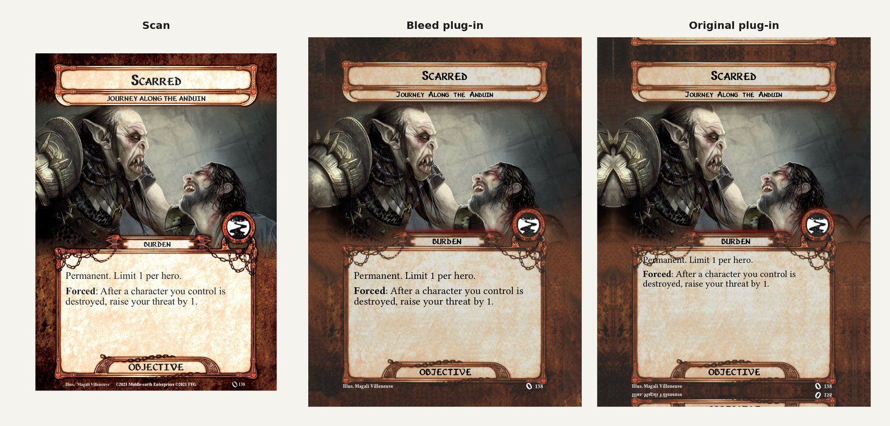
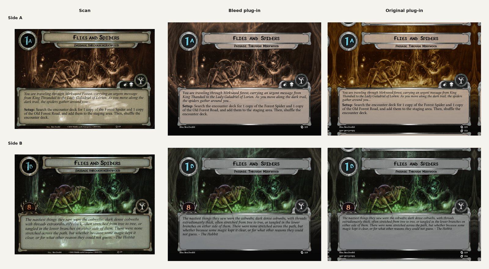
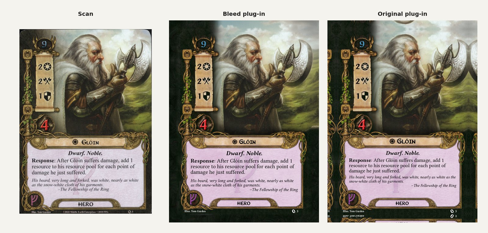
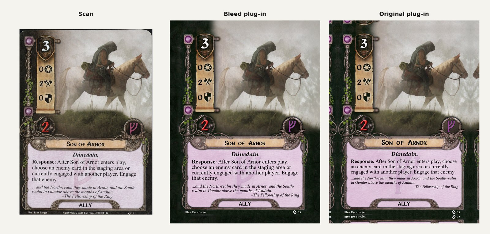
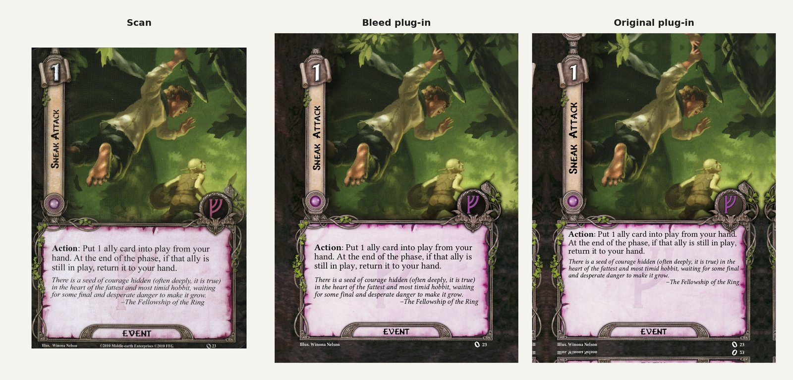
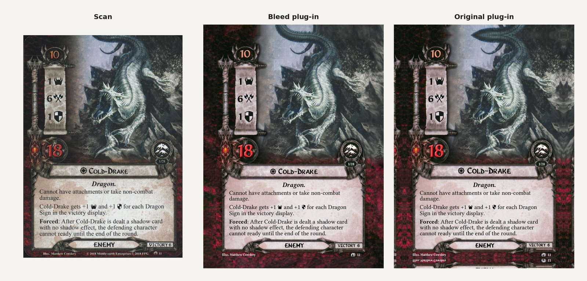
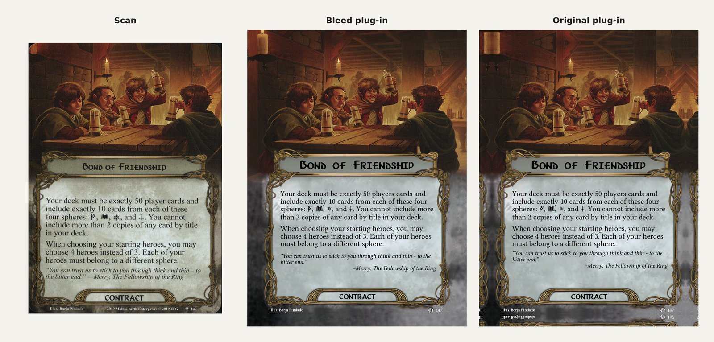
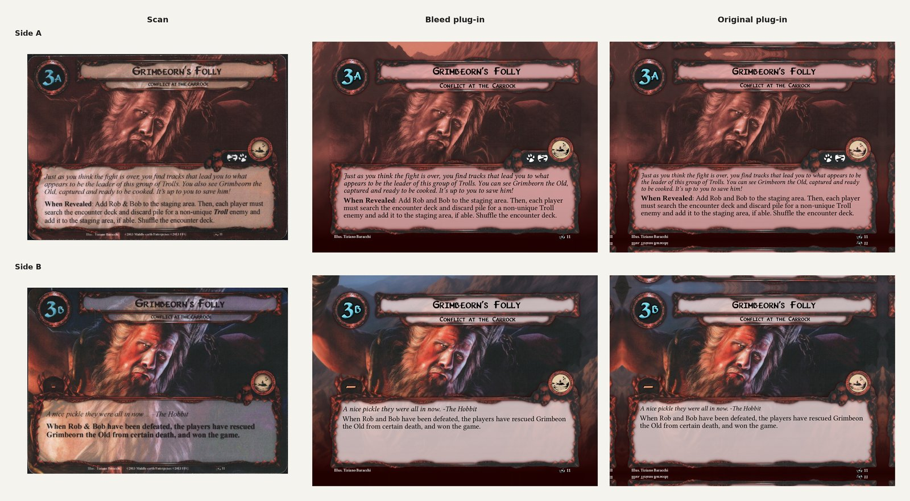

# The Lord of the Rings LCG, print bleed

A Strange Eons plug-in that adds print-ready **"… Bleed"** versions of the
_Lord of the Rings: The Card Game_ components. Their frames include a real
1/6" (12pt) bleed, so cards exported with a bleed margin show the actual frame
and artwork running past the trim, not Strange Eons' mirrored card edges.

The original components are untouched: the bleed versions are added alongside them.

**[⬇ Download the latest version](https://github.com/WebDevSimplified/lotr-lcg-strange-eons-bleed-plugin/releases/latest/download/TheLordOfTheRingsLCG-Bleed.seext)**
· [All releases and changes](https://github.com/WebDevSimplified/lotr-lcg-strange-eons-bleed-plugin/releases)

## Requirements

- Strange Eons 3, build 3970 or newer
- The Lord of the Rings LCG plug-in and its HD add-on (**Toolbox → Catalogue**,
  search `LRL`). Installed from the catalogue, these are pulled in for you.

## Install

1. Download `TheLordOfTheRingsLCG-Bleed.seext` from the
   [latest release](https://github.com/WebDevSimplified/lotr-lcg-strange-eons-bleed-plugin/releases/latest).
2. In Strange Eons, choose **Toolbox → Manage Plug-ins → Open Plug-in Folder**.
3. Copy `TheLordOfTheRingsLCG-Bleed.seext` into that folder.
4. Restart Strange Eons.

To **update**, do the same with the newer file, replacing the old one. To get
notified of new versions, use **Watch → Custom → Releases** at the top of this page.

## Use

1. **File → New**, then pick a component whose name ends in "Bleed" (for example, **Ally Bleed**).
2. When exporting or printing, turn on the bleed margin and export above 150 ppi
   (300 ppi recommended) to use the full-resolution bleed frames.

### Included components

Hero, Ally, Attachment, Event, Treasure, Gift, Contract, Campaign, Quest,
Nightmare Setup, Player and Encounter Side Quests, Enemy, Location, Location
Promo, Treachery, Objective and Objective Ally, including their Nightmare,
Boon, Burden, Ship and Promo variants.

Not included yet (no bleed frames): Divider, Haven, Occurrence, Presence,
Presentation, Quest Sheet, Rules Card, Scenario and Set.

## What's different from the original plug-in

**Bleed**

- Bleed frames for every included card type. Artwork extends into the bleed
  wherever it reaches the card's edge.

**Closer to the printed cards** (checked against card scans)

- Card names are slightly smaller and sit a little lower in their banners
  (Hero, Ally, Attachment, Event, Enemy, Location, Campaign).
- Player card rules text is slightly larger.
- Resource cost numbers are 10% larger.
- The victory box and its text are slightly larger and sit a little lower.
- Shadow text is left-aligned at full size. Flavour text has a little more space above it.
- Quest names and scenario subtitles are a little larger. Quest story text is full size.
- Nightmare setup cards have larger titles (long titles split onto two lines)
  and larger rules text.
- Side quest text has a little more padding from the top and sides of the box.
- Events, Treacheries and Burden Objectives with no traits leave a trait-sized
  gap above their text, like the printed cards.

**Other changes**

- Quests have a tint dropdown with a new sepia measured from real cards (see below).
- Nightmare cards use a black encounter set icon in their medallion.
- Sphere medallions and the Event/Gift ring are lightly retextured.
- New Heroes start with the standard layout rather than the promo layout.

## Quest artwork sepia

Quest Bleed cards can tint the front artwork sepia, as on the printed A sides.
Choose one in the tint dropdown on the **Portrait** tab:

| Option                 | Result                                                        |
| ---------------------- | ------------------------------------------------------------- |
| **New Tint** (default) | The printed cards' sepia, measured from scans of FFG's quests |
| **Original Tint**      | The Lord of the Rings LCG plug-in's own sepia                 |
| **No Tint**            | The artwork as uploaded                                       |

Upload your artwork in full colour and let the card tint it. Nightmare quests
use the original plug-in's red tint with either tint option.

## Flavour text alignment

Flavour text follows the original plug-in's preference, which is
right-aligned unless you change it. The printed cards use left-aligned flavour
text. To match them:

1. **Edit → Preferences** (on macOS, in the Strange Eons menu).
2. Choose **LotR LCG** in the list of categories.
3. Under **Text alignment**, set **Flavour text** to **Left**.
4. Close Preferences. Open cards redraw with the new alignment.

This setting applies to every LotR LCG card, with or without bleed.

## More comparisons

Each shows the printed card's scan, this plug-in, and the original plug-in with
Strange Eons' standard (mirrored) bleed.

## Uninstall

**Toolbox → Manage Plug-ins**, select **The Lord of the Rings LCG, print bleed**,
then **Uninstall**.

## Building and releasing

`plugin/` holds the plug-in's files; edit them directly. `npm install` once,
then `npm run build` zips them into `dist/TheLordOfTheRingsLCG-Bleed.seext`
(checking that everything they refer to exists). Try a build without
installing it with `strange-eons --pluginTest dist/TheLordOfTheRingsLCG-Bleed.seext`.

To publish a release, use **Actions → Release → Run workflow** (or
`npm run release -- --notes "…"`). Never change the UUID in `plugin/eons-plugin`'s
`id` line, or Strange Eons will treat the bundle as a different plug-in.

## Credits

Built on the LotR LCG plug-in by Daniel Tello (Karagh), with templates by
GeckoTH. For fans of the game; no commercial use. Not produced or endorsed by
Fantasy Flight Games.
